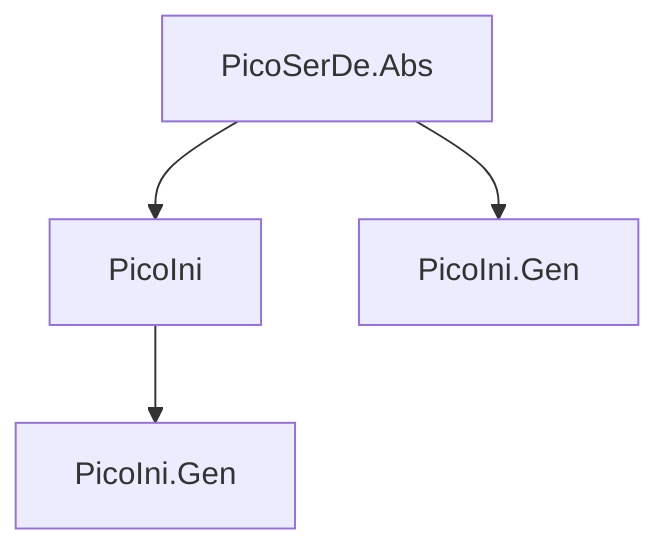

# PicoIni Design Spec

**Date:** 2026-05-26  
**Status:** Approved  
**Parent:** PicoSerDe ecosystem (follows PicoJetson patterns)

## Overview

PicoIni is a high-performance, AOT-first INI serialization library for the PicoHex ecosystem. It follows PicoJetson's architecture: zero-reflection source generation, `ref struct` reader/writer, and `ISerializer<T>`/`IDeserializer<T>` abstractions from PicoSerDe.Abs.

## Mapping Model: Section-per-Property

Each C# property of an object type maps to an `[SectionName]` in the INI file. Simple types (string, int, etc.) become `key = value` within that section. Top-level simple properties become header-level key-value pairs.

```
C#:                                      INI:
class AppConfig {                        ; Top-level simple props
  public string Title { get; set; }      Title = MyApp
  public int Version { get; set; }       Version = 1
  public ServerConfig Server { get; set; }
}                                         [Server]
                                          Host = localhost
class ServerConfig {                      Port = 8080
  public string Host { get; set; }
  public int Port { get; set; }
}
```

## Project Structure

```
PicoIni/
├── src/PicoIni/                    # net10.0, packable, IsAotCompatible
│   ├── IniSerializer.cs            # static facade: Serialize<T>, Deserialize<T>
│   ├── IniReader.cs                # ref struct INI reader (span + sequence modes)
│   ├── IniWriter.cs                # ref struct INI writer (IBufferWriter<byte>)
│   ├── IIniConverter.cs            # custom converter interface
│   ├── IniSectionAttribute.cs      # [IniSection("name")]
│   ├── IniKeyAttribute.cs          # [IniKey("key")]
│   ├── IniIgnoreAttribute.cs       # [IniIgnore]
│   ├── IniCommentAttribute.cs      # [IniComment("text")]
│   └── GlobalUsings.cs
├── src/PicoIni.Gen/                # netstandard2.0, Roslyn IIncrementalGenerator
│   ├── IniSerializerGenerator.cs   # detects IniSerializer calls, generates impl
│   ├── TypeKindResolver.cs         # type → kind string mapping
│   └── IsExternalInit.cs           # polyfill for record types
├── tests/PicoIni.Tests/            # TUnit, references PicoIni + PicoIni.Gen
├── benchmarks/PicoIni.Benchmarks/  # PicoBench, AOT-trimmed
└── samples/PicoIni.Sample/         # console demo, AOT-trimmed
```

## API Surface

```csharp
// High-level (source-generated)
IniSerializer.Serialize<T>(T value) → string
IniSerializer.SerializeToUtf8Bytes<T>(T value) → byte[]
IniSerializer.Serialize<T>(IBufferWriter<byte> writer, T value)
IniSerializer.Deserialize<T>(ReadOnlySpan<byte> data) → T?
IniSerializer.Register<T>(ISerializer<T>, IDeserializer<T>)

// Low-level reader (ref struct)
new IniReader(ReadOnlySpan<byte> data)
new IniReader(ReadOnlySequence<byte> data)
reader.Read() → bool
reader.TokenType: SectionStart | SectionEnd | Key | Value | Comment | None
reader.SectionName: ReadOnlySpan<byte>
reader.Key: ReadOnlySpan<byte>
reader.ValueSpan: ReadOnlySpan<byte>
reader.TryGetInt32/Int64/Float64/Bool(out v) → bool

// Low-level writer (ref struct)
new IniWriter(IBufferWriter<byte> buffer)
writer.WriteComment("text")
writer.WriteSection("name")
writer.WriteKeyValue("key", "value")
writer.WriteBlankLine()
```

## Type Support

| Category    | Types                                                       |
|-------------|-------------------------------------------------------------|
| Primitives  | string, int, long, float, double, bool, decimal             |
| Temporal    | DateTime, DateOnly, TimeOnly, TimeSpan                      |
| Special     | Guid, enums                                                 |
| Collections | List<T>, T[], comma-separated and repeated-key              |
| Nested      | Object types → sections                                     |
| Nullable    | Nullable<T> for value types                                 |
| Custom      | [IniConverter] + IIniConverter<T>                           |

## INI Feature Support

| Feature              | Read | Write | Notes                              |
|----------------------|------|-------|-------------------------------------|
| Sections [name]      | ✅   | ✅    | Section-per-property mapping       |
| Key = Value          | ✅   | ✅    | Typed serialization                |
| `;` comments         | ✅   | ✅    | Via [IniComment] attribute         |
| `#` comments         | ✅   | ✅    | Both comment styles                |
| Quoted values        | ✅   | ✅    | `key = "value with spaces"`        |
| Escape sequences     | ✅   | ✅    | `\n \t \\ \"` in quoted values     |
| Multi-line (cont)    | ✅   | —     | `\` at end of line                 |
| Multi-line (indent)  | ✅   | —     | Indented continuation lines        |
| Comma-sep collections| ✅   | ✅    | `Tags = a, b, c`                   |
| Repeated keys        | ✅   | —     | Merge to list                      |
| Case-insensitive     | ✅   | ✅    | Section/key names                  |

## INI Reader Grammar

```
ini-file      = { whitespace | comment | section | key-value }
section       = "[" section-name "]" { whitespace | comment | key-value }
key-value     = key "=" value { whitespace | comment }
comment       = (";" | "#") any-char* newline
key           = unquoted-char+
value         = unquoted-value | quoted-value
unquoted-value = [^\n\r]*  ; trimmed
quoted-value  = '"' { any-char | escape } '"' | '\'' { any-char } '\''
escape        = "\" ( "n" | "t" | "r" | "\" | "\"" | "'" )
continuation  = "\" newline
indent-cont   = newline whitespace+ no-section-or-key
```

## Attributes

| Attribute                    | Target       | Effect                                    |
|------------------------------|-------------|-------------------------------------------|
| `[IniSection("name")]`       | Property     | Override section name in INI              |
| `[IniKey("name")]`           | Property     | Override key name in INI                  |
| `[IniIgnore]`                | Property     | Exclude from serialization                |
| `[IniComment("text")]`       | Class/Prop   | Emit comment before section or key        |
| `[IniConverter(typeof(T))]`  | Property     | Custom IIniConverter<T> for this property |

## Source Generator

Follows PicoJetson.Gen pattern exactly:
- `IIncrementalGenerator` detecting `IniSerializer.Serialize<T>()` / `Deserialize<T>()` calls
- Generates `file readonly struct` implements `ISerializer<T>` + `IDeserializer<T>`
- Auto-registration via `[ModuleInitializer]`
- Section-per-property: each object-typed property → `writer.WriteSection(name)`
- Simple properties → `writer.WriteKeyValue(name, value)`
- Collections → comma-separated or repeated-key output

## Differences from PicoJetson

| Aspect            | PicoJetson                    | PicoIni                     |
|-------------------|-----------------------------|-----------------------------|
| Structure         | Arbitrary nesting           | 2-level (section + key)     |
| Token complexity  | 20 token types              | 5 token types               |
| SIMD              | Whitepsace + backslash      | Not needed (simpler format) |
| Comments          | Not supported               | First-class: `;` and `#`    |
| Value quoting     | Required for strings        | Optional (only if needed)   |
| Arrays            | `[1,2,3]` native            | Comma-sep or repeated key   |

## Dependencies



- `PicoIni` → `PicoSerDe.Abs` (project reference)
- `PicoIni.Gen` → `Microsoft.CodeAnalysis.CSharp 4.*` (generator only)
- Zero additional runtime dependencies

## CI/CD Integration

- Add PicoIni projects to `PicoSerDe.slnx`
- Extend CI matrix to build/test PicoIni
- Add PicoIni to release pipeline (pack order: Abs → PicoIni.Gen → PicoIni)

## Test Strategy (TDD)

Development follows TDD: tests written first, implementation to make them green.

### Test Phases
1. **Reader tests** — token parsing, comments, escapes, edge cases
2. **Writer tests** — output formatting, escaping, comments
3. **Serializer manual tests** — hand-written ISerializer/IDeserializer impls (golden reference)
4. **Source generator tests** — generated code matches golden reference
5. **Integration tests** — IniSerializer facade with generated code
6. **Round-trip tests** — serialize → deserialize → assert equality
7. **Fuzzing tests** — random INI input validation
